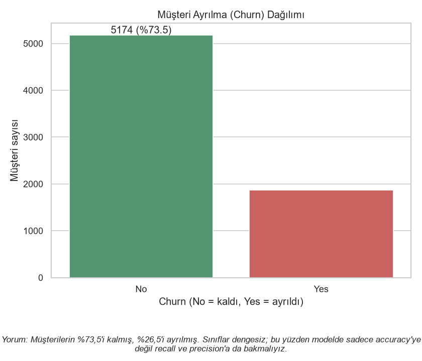
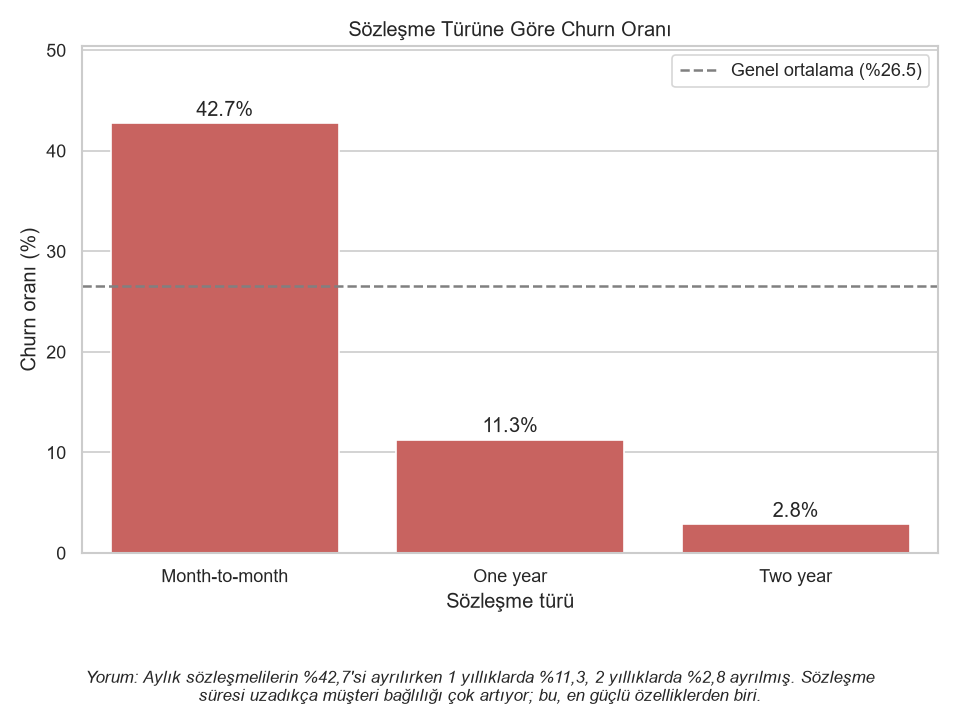
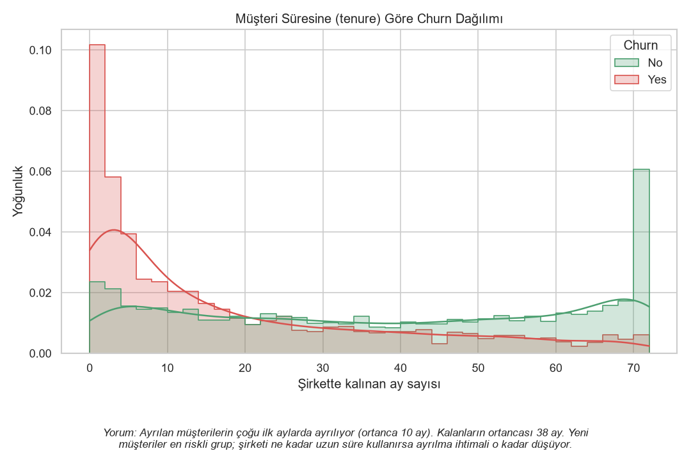
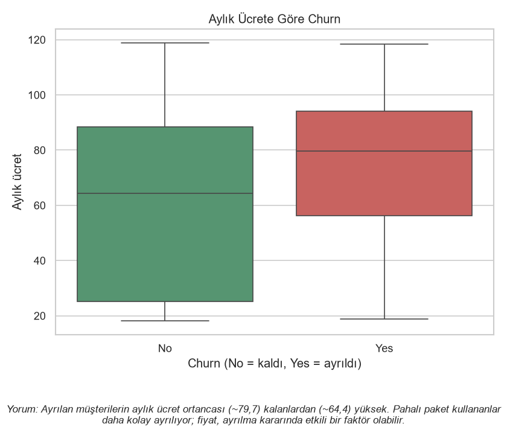
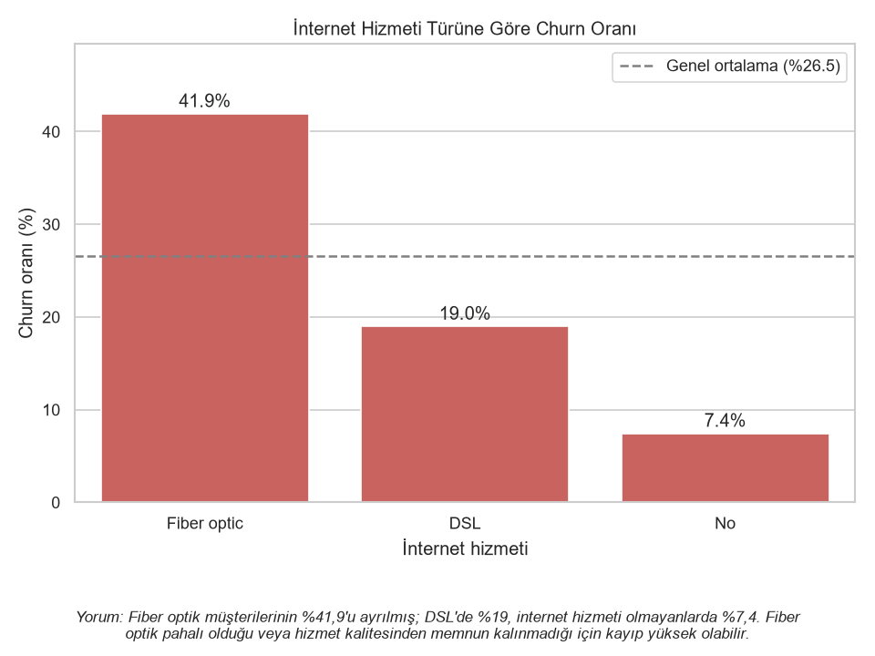
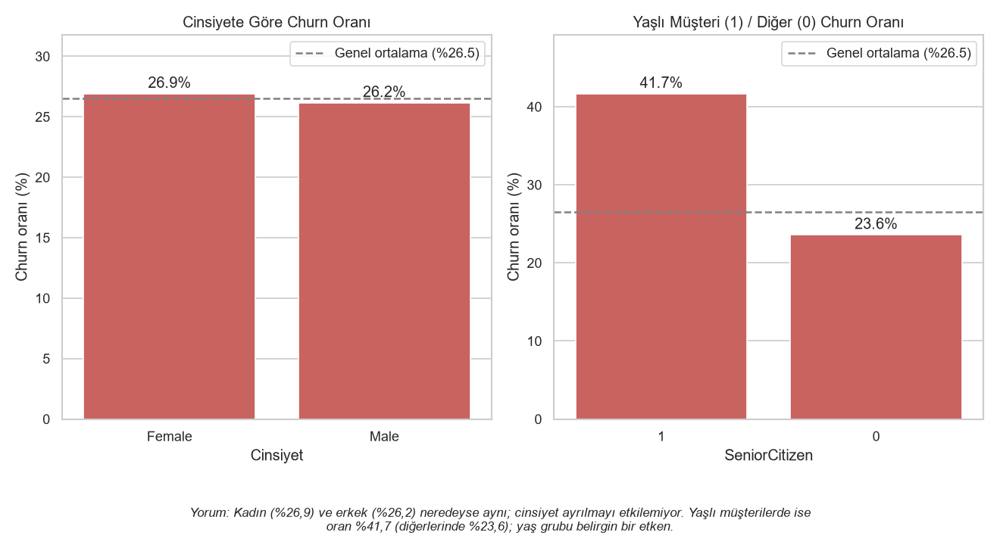
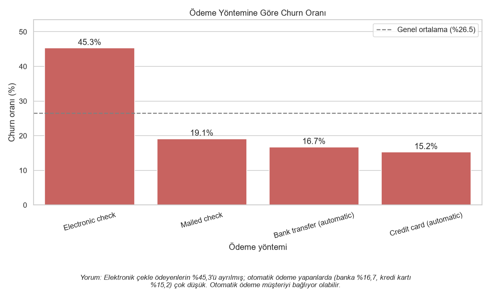
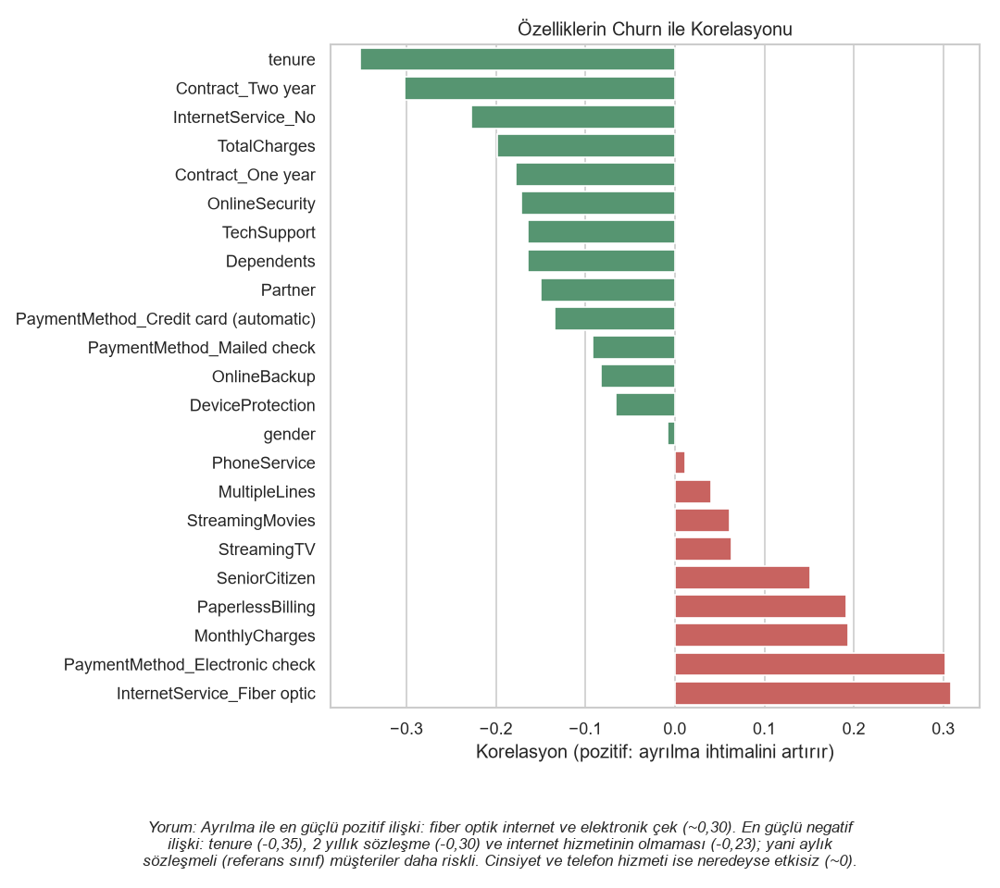
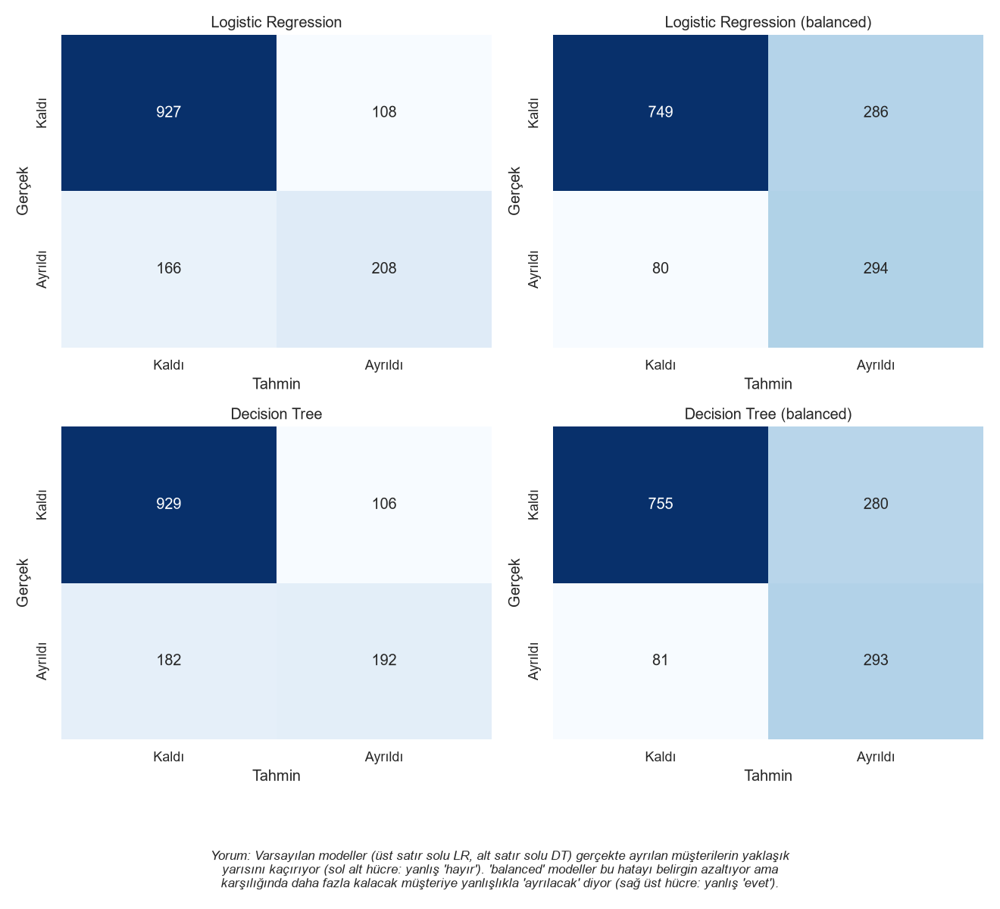
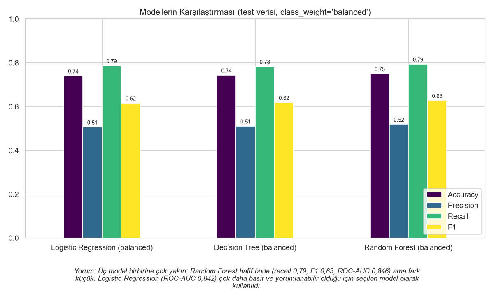

# Telco Müşteri Kaybı (Churn) Sınıflandırma Raporu

**Amaç:** Bir müşterinin aboneliğini bırakıp bırakmayacağını (Churn = Yes/No) tahmin etmek.
**Veri seti:** `IT_customer_churn.csv` (Telco Customer Churn). 7043 müşteri, 19 özellik + hedef sütun.
**Kod:** `tekno.py` (analiz ve model), `app.py` (Streamlit arayüzü).
**Kütüphaneler:** pandas, numpy, matplotlib, seaborn, scikit-learn, joblib, streamlit.

---

## 1. Veriyi Tanıma

| Grup | Sütunlar |
|---|---|
| Demografik | gender, SeniorCitizen, Partner, Dependents |
| Hizmet | PhoneService, MultipleLines, InternetService, OnlineSecurity, OnlineBackup, DeviceProtection, TechSupport, StreamingTV, StreamingMovies |
| Hesap / ödeme | tenure (kalınan ay), Contract, PaperlessBilling, PaymentMethod, MonthlyCharges, TotalCharges |
| **Hedef** | **Churn** (Yes = ayrıldı, No = kaldı) |

**Sınıf dağılımı:**

| Churn | Adet | Yüzde |
|---|---|---|
| No (hayır) | 5174 | %73,46 |
| Yes (evet) | 1869 | %26,54 |

Sınıflar **dengesiz** (oran yaklaşık 2,77). Herkese "kalır" diyen bir model bile yaklaşık %73 accuracy alır. Bu yüzden accuracy tek başına yeterli değildir, precision, recall ve confusion matrix de incelenmiştir.

## 2. Veri Temizleme

- **TotalCharges** metin tipindeydi ve 11 satırda boş (`" "`) değer vardı. Sayıya çevrildi. Bu 11 satırın hepsinde `tenure = 0` olduğu için (henüz ödeme yapmamış yeni müşteriler) değerler 0 ile dolduruldu.
- Veri setinde ID sütunu yok, silinecek gereksiz sütun yok.
- 22 tekrar eden satır var. ID olmadığı için farklı müşteriler olabilecekleri düşünülerek silinmedi.
- "No internet service" ve "No phone service" değerleri, bilgi başka sütunlarda zaten bulunduğu için "No" yapıldı.
- **Kategorik dönüşüm:** Churn ve ikili sütunlar 0/1 yapıldı. InternetService, Contract ve PaymentMethod için one-hot encoding (`drop_first=True`) kullanıldı. Sonuç: 7043 × 24 sayısal tablo, eksik değer yok.

## 3. Görselleştirme

Her grafiğin altında yorumu da bulunur (`grafikler/` klasörü).

### 3.1 Churn dağılımı

Müşterilerin %73,5'i kalmış, %26,5'i ayrılmış. Sınıflar dengesiz olduğu için sadece accuracy'ye güvenilmemeli.

### 3.2 Sözleşme türü

Aylık sözleşmelilerde ayrılma %42,7, 1 yıllıklarda %11,3, 2 yıllıklarda %2,8. Sözleşme süresi uzadıkça bağlılık çok artıyor.

### 3.3 Müşteri süresi (tenure)

Ayrılanların ortanca süresi 10 ay, kalanlarınki 38 ay. Yeni müşteriler en riskli grup.

### 3.4 Aylık ücret

Ayrılanların aylık ücret ortancası (~79,7) kalanlardan (~64,4) yüksek. Fiyat, ayrılma kararında etkili olabilir.

### 3.5 İnternet hizmeti

Fiber optikte ayrılma %41,9, DSL'de %19, internet hizmeti olmayanlarda %7,4.

### 3.6 Cinsiyet ve yaşlı müşteri

Kadın (%26,9) ve erkek (%26,2) neredeyse aynı, yani cinsiyet etkisiz. Yaşlı müşterilerde oran %41,7 (diğerlerinde %23,6).

### 3.7 Ödeme yöntemi

Elektronik çekte ayrılma %45,3. Otomatik ödemelerde (banka %16,7, kredi kartı %15,2) çok düşük.

### 3.8 Korelasyon

Ayrılmayla en güçlü pozitif ilişki: fiber optik (+0,31) ve elektronik çek (+0,30). En güçlü negatif ilişki: tenure (-0,35) ve 2 yıllık sözleşme (-0,30). Cinsiyet ve telefon hizmeti neredeyse etkisiz.

## 4. Model

- **Ayrım:** %80 eğitim (5634), %20 test (1409). `random_state=42`, `stratify=y` (iki parçada da churn oranı %26,54).
- **Ölçekleme:** `StandardScaler` sadece tenure, MonthlyCharges ve TotalCharges için, `Pipeline` içinde, yalnızca eğitim verisine fit edildi (veri sızıntısı yok).
- **Modeller:** Logistic Regression, Decision Tree (ve bonus olarak Random Forest). Her biri `class_weight='balanced'` ile ve (LR, DT için) onsuz denendi.
- **Decision Tree derinliği:** Test verisine bakılmadan, eğitim verisinde 5 katlı çapraz doğrulama ile seçildi (`max_depth=4`). Sınırsız derinlikte ağaç eğitimde 0,998, testte 0,735 accuracy verdi, yani eğitim verisini ezberledi.

## 5. Sonuçlar (test verisi, pozitif sınıf = Ayrıldı)

| Model | Accuracy | Precision | Recall | F1 |
|---|---|---|---|---|
| Logistic Regression | 0,806 | 0,658 | 0,556 | 0,603 |
| Logistic Regression (balanced) | 0,740 | 0,507 | **0,786** | 0,616 |
| Decision Tree | 0,796 | 0,644 | 0,513 | 0,571 |
| Decision Tree (balanced) | 0,744 | 0,511 | **0,783** | 0,619 |

**Confusion matrix** (ayrıntılı görsel): 

| Model | Yanlış "hayır" (FN) | Yanlış "evet" (FP) |
|---|---|---|
| Logistic Regression | 166 | 108 |
| Logistic Regression (balanced) | 80 | 286 |
| Decision Tree | 182 | 106 |
| Decision Tree (balanced) | 81 | 280 |

Testte 374 gerçek "ayrıldı" ve 1035 gerçek "kaldı" müşteri var. Varsayılan modeller ayrılanların yaklaşık yarısını kaçırıyor. `balanced` modeller FN'yi yarıya indiriyor, karşılığında FP yaklaşık 2,6 kat artıyor.

### Yanlış "hayır" mı, yanlış "evet" mi daha kötü?

**Yanlış "hayır" (False Negative) daha kötüdür.**

- **Yanlış "hayır":** Gerçekte ayrılacak müşteriye "kalır" denir. Önlem alınmaz, müşteri ve gelecekteki geliri kaybedilir. Yeni müşteri kazanmak, mevcut müşteriyi elde tutmaktan genellikle çok daha pahalıdır.
- **Yanlış "evet":** Gerçekte kalacak müşteriye "ayrılır" denir. Sonuç, gereksiz bir indirim veya arama kampanyasıdır. Maliyeti sınırlı ve telafi edilebilir.

Bu yüzden **recall** öncelikli ölçüttür. `balanced` modeller recall'u %51-56'dan %78-79'a çıkardığı için bu problemde daha uygundur. Accuracy'nin %80'den %74'e düşmesi kabul edilebilir bir bedeldir. Precision tamamen göz ardı edilmemelidir, çünkü çok düşerse kampanya bütçesi boşa harcanır.

> Not: Kodda FN maliyetinin FP'nin 5 katı olduğu **varsayılarak** basit bir maliyet karşılaştırması da yapılmıştır. Bu oran veriden çıkmaz, bir varsayımdır.

## 6. Bonus

### 6.1 Model karşılaştırması

| Model (balanced) | Accuracy | Precision | Recall | F1 | ROC-AUC |
|---|---|---|---|---|---|
| Logistic Regression | 0,740 | 0,507 | 0,786 | 0,616 | 0,842 |
| Decision Tree | 0,744 | 0,511 | 0,783 | 0,619 | 0,818 |
| Random Forest | 0,750 | 0,519 | 0,794 | 0,628 | 0,846 |

Üç model birbirine çok yakın, Random Forest hafif önde. Basit ve yorumlanabilir olduğu için **Logistic Regression (balanced)** seçildi.

### 6.2 Yanlış tahmin analizi (Logistic Regression, balanced)

- **Yanlış "hayır" (80 kişi):** En emin yanılgılar uzun süreli (48-72 ay), 1-2 yıllık sözleşmeli, otomatik ödemeli, teknik destek alan müşteriler (ayrılma olasılığı %2-7 verilmiş). Bu müşterilerin neden ayrıldığı (taşınma, rakip teklifi vb.) veri setinde olmadığı için model bunu öğrenemez.
- **Yanlış "evet" (286 kişi):** Kısa süreli, aylık sözleşmeli, fiber optik, elektronik çekle ödeyen müşteriler (olasılık %91-92). Bunlar gerçekten en riskli profil, bu müşteriler bu sefer kalmış. Bu grup doğru yakalanan ayrılanlara çok benziyor.
- **Sonuç:** Hataların büyük kısmı modelden çok verideki eksik bilgiden kaynaklanıyor.

### 6.3 Streamlit arayüzü
`python tekno.py` ile model `churn_model.joblib` olarak kaydedilir, ardından `streamlit run app.py` ile arayüz açılır.

- **Tahmin sekmesi:** Müşteri bilgileri girilir (profil, sözleşme/ödeme, hizmetler). Model, müşterinin aboneliği bırakıp bırakmayacağını **evet / hayır** olarak ve **ayrılma olasılığıyla** (eşik %50) gösterir. Sonuç her değişiklikte anında güncellenir. "Neden bu tahmin?" grafiği, riski en çok artıran ve azaltan faktörleri gösterir. "Riskli" ve "sadık" müşteri örnek butonları vardır.
- **Model hakkında sekmesi:** Test verisindeki accuracy, precision, recall, F1, ROC-AUC değerleri ve confusion matrix.
- Toplam ücret sorulmaz, süre × aylık ücret ile tahmin edilir (basitleştirme).

## 7. Genel Sonuç

- Ayrılmayı en çok etkileyen özellikler: **sözleşme türü, müşteri süresi, internet türü (fiber optik) ve ödeme yöntemi**. Cinsiyetin etkisi yok.
- En riskli profil: yeni, aylık sözleşmeli, fiber optik kullanan, elektronik çekle ödeyen müşteri.
- Sınıflar dengesiz olduğu için accuracy yanıltıcıdır. Asıl hedef ayrılacak müşterileri kaçırmamak (yüksek recall) olduğundan `class_weight='balanced'` modeller tercih edildi (recall ≈ %79, precision ≈ %51).
- İyileştirme fikirleri: eşik değeri ayarı, hiperparametre araması, müşteri memnuniyeti gibi ek veriler.
